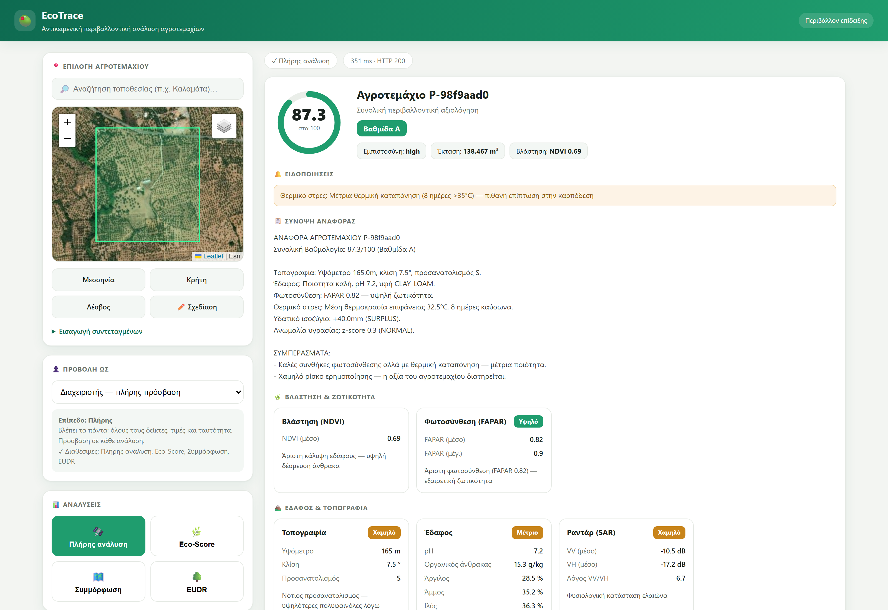
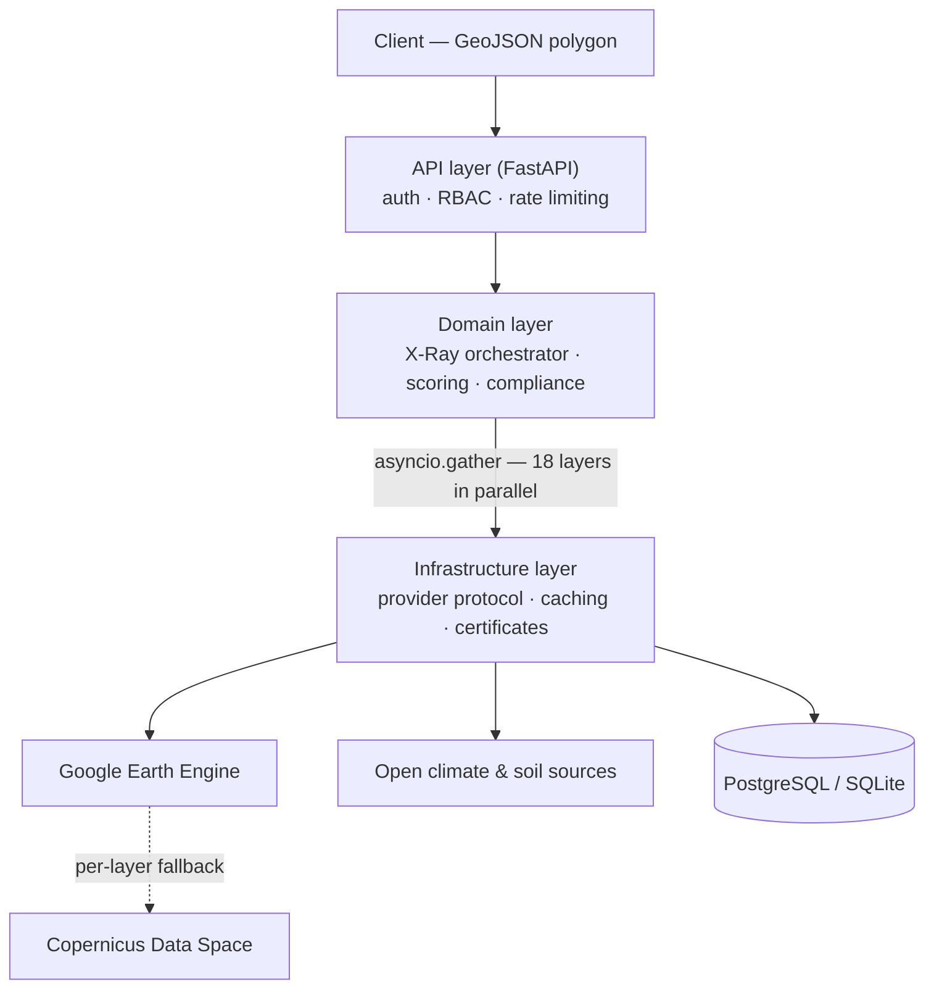

# EcoTrace

*Αντικειμενική περιβαλλοντική ταυτότητα για κάθε αγροτεμάχιο*

**Environmental intelligence for agricultural parcels, built on open satellite data.**

EcoTrace is a production-grade analysis platform developed end to end as a solo project:
geospatial pipelines over open satellite and climate sources, an asynchronous 18-layer analysis
engine, research-backed scoring models, a role-aware API and a demonstration UI. The initial
domain is Greek olive cultivation; the core is designed crop-agnostic.

Greece produces some of the world's most distinctive olive oil, yet the environmental story of
each grove still lives on paper. Open satellite archives already hold that story — EcoTrace
reads it directly from the land itself: polygon-first and identity-optional, so a producer
never has to hand their trust to yet another opaque digital system.

*Demonstration environment with deterministic mock satellite data; the interface is in Greek,
matching the intended users. Response times shown reflect the mock providers — a live analysis
of a fresh parcel takes a few seconds for the full 18-layer fan-out, and repeat requests are
served from cache.*

## Overview

The platform accepts a parcel polygon (GeoJSON) and returns, within seconds:

- an **18-layer environmental profile** spanning vegetation vigor, soil and terrain,
  climate and water, and risk indices
- an **Eco-Score (0–100)** with grade, confidence level and a plain-language summary
- **regulatory screening**, including protected-area overlap (Natura 2000)
- a **verifiable PDF certificate** with QR verification and a SHA-256 integrity hash

All outputs are computed exclusively from open satellite and climate archives (Copernicus,
NASA and other public sources). Where appropriate, responses are filtered by the caller's
role — some roles receive only aggregate indicators, never raw satellite values.

## Architecture

The codebase follows strict layering (API → Domain → Infrastructure → Core). Satellite access
sits behind a `SatelliteProvider` protocol with automatic fallback, and faults are isolated per
layer: a failing upstream source lowers the confidence of a single layer — it never fails the
request.

## Engineering highlights

- **Scientific honesty, enforced** — empirical models carry literature citations and an
  explicit `model_note` stating their limitations; statuses report `PLAUSIBLE`, never
  `VERIFIED`, where the data cannot prove more. When a NASA data product was sunset, it was
  replaced with citable physics (FAO-56), not a convenient proxy.
- **Resilience by design** — automatic provider fallback, per-layer graceful degradation,
  fail-closed rate limiting and fail-closed RBAC.
- **Discipline at solo scale** — ~14.5k lines of production Python plus ~5.8k of tests,
  15 Architecture Decision Records, CI-guarded migrations, documentation-first rule.
- **Deterministic offline mode** — the platform runs end to end without external credentials;
  the same mode drives the automated tests and the demonstration above.

## Development workflow

The project is developed with AI coding agents (Claude Code and comparable tools) operating
under an explicit project contract: a documentation-first rule, automated lint and formatting
hooks on every edit, a dedicated review agent enforcing the scientific-honesty convention, and
an Architecture Decision Record for every significant choice. Architecture, domain decisions
and final review remain human-owned; the agents provide throughput under those constraints.

## Technology stack

Python 3.12 · FastAPI · Pydantic · SQLAlchemy 2.0 · Alembic · Celery · Redis ·
PostgreSQL · Docker · nginx · GitHub Actions · pytest · ruff

## Status, source and contact

Active personal project, developed alongside an MSc in Applied Statistics & Data Analytics
(Athens University of Economics and Business); part of its development is planned to become
the MSc thesis.

The source code is private. **Read access is available on request** for recruiting and
interview purposes. The same contact serves **product and partnership inquiries** — pilots,
integrations, early access — should the platform reach general availability.

**Andreas Nazos** — [@andnazos](https://github.com/andnazos) · andnazos@gmail.com

---

*© 2026 EcoTrace. All rights reserved. This repository is a public showcase; it contains no
source code or proprietary documentation.*
